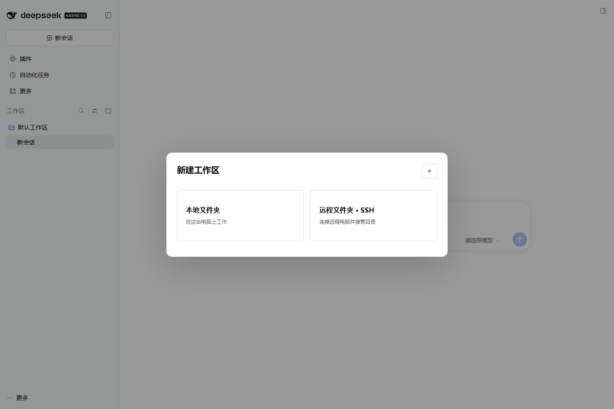

# DSH SSH 远程工作区

DeepSeek Harness 的标准 SSH 插件。在新建工作区时选择本地或远程文件夹，通过 SSH 接管远端目录。提供独立连接配置、指纹确认、连接检查、SFTP 目录浏览、远端运行时安装、桌面内远程界面和连接管理。



首版目标宿主 **DSH 0.2.1-rc.3**，本机 Windows，远端 **Linux / macOS + POSIX shell + Node.js ≥22.12.0 + npm**。远端需开放 SSH、启用 SFTP 与 TCP 转发；不需要向公网开放 DSH 端口。远端 Windows 暂不支持。测试覆盖与尚未验证的部分见 [验证记录](docs/VALIDATION.md)。

## 在软件中安装

发行文件：`dist/deepseek-harness-ssh-0.1.0.tgz`。

1. 打开 DSH **插件 → 添加插件**。
2. 在“包名或地址”填写 `.tgz` 的本机绝对路径，例如：

   ```text
   D:\code\dsh-plugin\deepseek-harness-ssh\dist\deepseek-harness-ssh-0.1.0.tgz
   ```

3. 安装并点击 **立即启用**；如宿主提示重启，按提示操作。

包内含构建产物和纯 JavaScript SSH 依赖，安装不要求编译原生模块。开发源码使用 `npm ci --ignore-scripts --omit=optional`，再 `npm run pack:plugin` 生成安装包。当前尚未发布 GitHub Release 或 npm；不要只输入裸包名。

## 配置远程电脑

打开侧栏底部 **更多 → 设置 → SSH 远程工作区**，编辑并保存：

```sshconfig
Host my-server
  HostName 192.168.1.20
  User developer
  Port 22
  IdentityFile ~/.ssh/id_ed25519
  # NodePath /usr/local/bin/node

Host bastion
  HostName gateway.example.com
  User developer
  IdentityAgent default

Host private-server
  HostName 10.0.0.20
  User developer
  ProxyJump bastion
  IdentityFile "C:\My Keys\id_ed25519"

Host *
  ConnectTimeout 15
  ServerAliveInterval 15
```

- 配置独立保存在 `$DSH_HOME/plugins/deepseek-harness-ssh/config`；默认 Windows 为 `%USERPROFILE%\.dsh\plugins\deepseek-harness-ssh\config`。不会读写 VS Code 配置或 `~/.ssh/config`。
- 仅支持上例指令及 `IdentityAgent none`。首个匹配值优先；支持 `Host *` 默认值、多个确切别名、注释、引号及 `Key=Value`。不支持通配 Host、Include、ProxyCommand 或任意本地命令。
- `IdentityFile` 指向本机私钥，可引用既有 SSH 密钥。配置私钥时默认不尝试 Agent；否则默认使用本机 SSH Agent。Windows 支持 OpenSSH Agent 管道。Agent 不转发给远端。
- 使用密码或加密私钥时，展开“临时认证”，输入密码或口令；跳板机有独立输入框。内容只存在界面与操作内存中，不写入配置，不使用浏览器持久存储。关闭窗口后需重新输入。
- 首次连接会显示 SHA256 指纹。请向管理员核对后点击“指纹一致，信任并继续”；已信任指纹变化时阻止连接。指纹库为插件独立的 `known-hosts.json`。
- 设置 `NodePath` 为远端 Node 可执行文件的绝对路径，可解决非交互 SSH 环境未加载 nvm 等 PATH 的问题；运行时安装仍需要 PATH 中有 npm。

## 检查连接与准备远端

选择主机，点击 **检查连接**，依次检查 SSH 认证、SFTP 主目录、远端 Node 与插件管理的 DSH 版本。SSH 成功但运行时缺失时，会分别说明。

远端已有 Node ≥22.12.0 与 npm 后，点击 **安装远端 DSH 运行时… → 开始远端安装**。插件通过 SSH 在远端 `~/.dsh-ssh/runtime/0.2.1-rc.3` 安装固定版本 `@deepseek-ai/dsh@0.2.1-rc.3`，不改远端全局 npm 安装。首次需要远端能访问 npm，安装可能需要数分钟；界面可取消。

## 创建与使用工作区

1. 点击工作区区域的新增文件夹按钮，或按 DSH 的新增工作区快捷键。
2. 先选择 **本地文件夹** 或 **远程文件夹 · SSH**。本地可浏览或填写绝对路径。
3. 远程选择已保存主机，填写临时认证（如需），点击 **浏览目录**，逐层进入项目，或直接输入 `/home/user/project`、`~/project`。
4. 点击 **连接并创建远程工作区**。桌面内显示远程 DSH，顶部标明主机和路径。
5. 在远端界面配置模型账号或 API Key，再正常聊天、浏览文件、预览文件、使用终端与权限审批。

原生文件侧栏、终端和模型工具均连接远端 Host，因此读写与执行属于同一台电脑。聊天、项目目录、Git 和远端权限由远端 DSH 管理。首次账号配置需在远端完成，不会自动复制本机模型密钥、插件或会话。

**返回本地** 保持远程连接；可在 SSH 设置的连接列表重新打开或断开。最近成功打开的远程目录会持久保存，下次新建可直接选择。SSH 断线后显示重连界面；临时认证不会自动记住，必要时返回本地重新输入。不会因断线改到本地执行远程任务。

## 架构、数据和限制

当前宿主工作区的身份校验使用本机 `fs.realpath/stat`，没有可注册的 SSH 工作区 provider。因此插件使用官方 SSH 使用方式：远端完整 DSH Web Host，通过加密 SSH 隧道在本地回环随机端口提供给桌面内 iframe。它不是将远程目录伪装成本地目录。原生左栏显示的是远端 Host 自己的工作区；本地和远程 Host 的会话列表互相独立。

- 远端工作区数据位于 `~/.dsh-ssh/workspaces/<目录 SHA256 前24位>/`，同一目录重连使用同一数据目录。远端运行时、工作区数据不会因本机卸载而删除。
- 本机配置、指纹、最近目录位于插件数据目录；账号密码和带 token 的启动 URL 不写入这些文件。启动 token 仅在当前界面和进程内存中使用。
- SSH 与远端 DSH 都只监听回环地址。远端 Host 增加指定本地隧道端口的 Host 信任，仍使用 DSH 原生启动 token、Cookie、Origin 校验和审批机制。
- 本地 HTTP 网关通过 SSH 转发请求；为兼容桌面 `dsh-app://` 的跨站嵌入，仅将原生登录 Cookie 转为 `HttpOnly; SameSite=None; Secure; Partitioned`，由浏览器按顶层站点隔离。网关不保存/伪造登录 Cookie，不注入认证，其他站点和未登录请求仍需远端原生认证。要求支持分区 Cookie 的现代 Chromium（DSH 0.2.1-rc.3 的桌面浏览器）。
- 同时最多连接 4 个远程工作区；断开会停止本插件启动的远端 Host，远端磁盘数据保留。网络中断后的进程回收依赖远端 SSH 会话 EOF / 信号传播；插件不能对远端突然断电提供进程回收保证。
- 首版不支持远端 Windows、交互 MFA / keyboard-interactive、任意 OpenSSH 指令、端口转发规则编辑、X11、Agent 转发、会话在本地与远端之间迁移。
- 远端原生插件需另行安装。涉及浏览器弹窗、原生桌面专属能力、Office 转换等依赖功能，以远端 DSH 与浏览器环境支持情况为准。

## 开发与验证

```powershell
npm ci --ignore-scripts --omit=optional
npm run build
npm test
npm run test:host
npm run test:ui
npm run test:install
npm run pack:plugin
```

核心测试建立本地真实加密 SSH/SFTP 服务，无需外部电脑。宿主与 UI 测试需要合法的 DSH 0.2.1-rc.3 运行时，设置 `DSH_DEV_RUNTIME` 为 `node_modules` 路径；UI 测试另需 `SSH_PLAYWRIGHT` 指向 Playwright 的 `index.mjs`，可选 `SSH_CHROMIUM`。测试数据、临时 Host、SSH 服务和截图全部在 `artifacts/`，不会操作用户正在使用的 DSH 配置。

本项目使用独立 Git 仓库，设计与阶段见 [实现计划](docs/PLAN.md)。MIT License；与 DeepSeek 官方无隶属关系。
