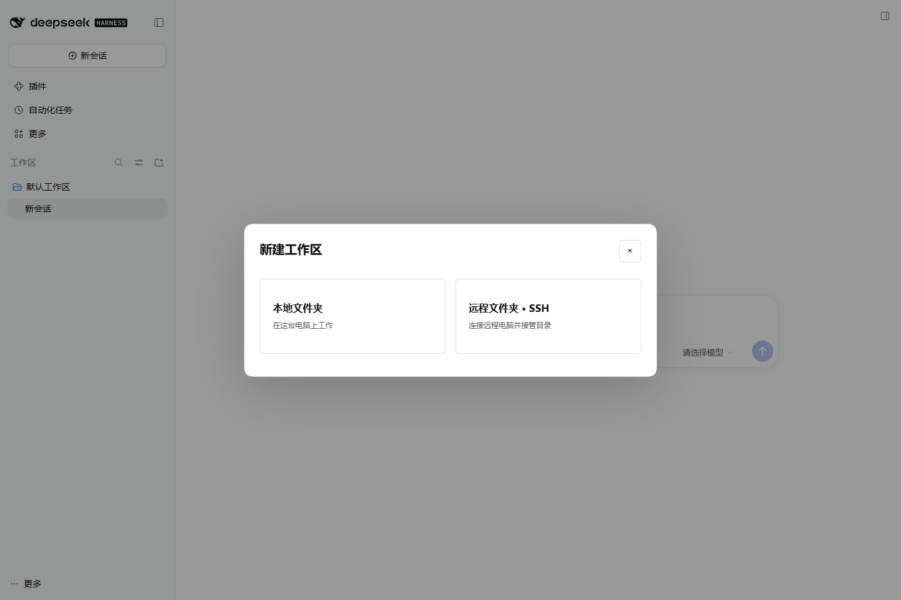
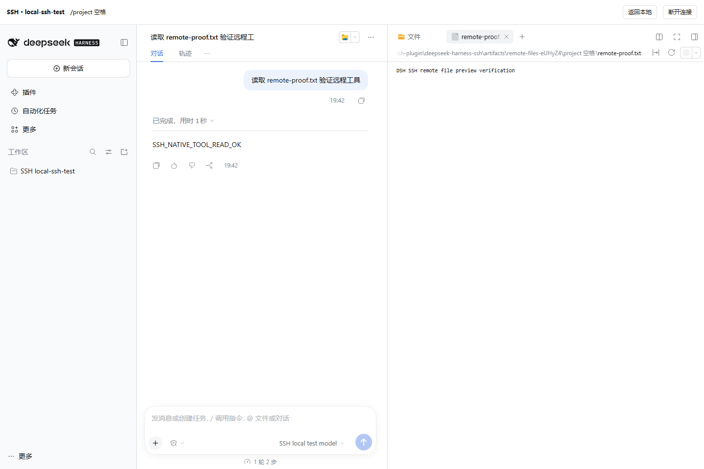

# 验证记录

## 0.1.1 实机验证（2026-10-26）

- 用户已在 VS Code 连通的 Rocky Linux 9 服务器：Linux 5.14、glibc 2.34、Node 24.21.0、DSH 0.2.1-rc.3。
- 系统 PATH 原先没有 Node/npm；在用户独立的 `~/.dsh-ssh/tools` 准备符合版本的 Node，按 npm Registry 的 SHA512 完整性元数据校验并安装 npm 11.13.0，再实际安装固定版本 DSH。未改系统或 VS Code 文件。
- 用插件的真实生产代码完成 SSH 私钥认证、SFTP、运行时探测、远端 Host 启动、SSH HTTP 隧道、原生签名 Cookie 身份校验与未登录请求拒绝。
- 在 `~/.dsh-ssh/validation/workspace` 的专用验证目录中，用无外部请求的测试模型调用真实 DSH `read` 工具，读取实机测试文件，并在原生文件侧栏打开预览；浏览器 pageerror 为 0。没有使用或复制用户模型密钥。
- 0.1.1 安装到用户实际 Desktop profile，保留原有插件、模型设置与会话；在真实 `dsh-app://app` 桌面打开 SSH 设置，成功执行真实服务器连接检查。
- 实际在 `dsh-app://app` 内打开真实服务器主目录，验证分区 Cookie 认证与远端工作区显示；适配 Windows 原生标题栏，避免连接条与桌面菜单重叠。
- 核心测试共 **17 项通过**，新增：密码缺失的可操作提示、密码错误重输、加密私钥口令、keyboard-interactive 密码、验证码与一次性密码不接收登录密码、Desktop 安装器保留既有配置及重复更新。
- 浏览器验证了“首次信任 → 提示密码 → 错误密码 → 重输成功”、新建窗口自动询问密码后继续原来的目录浏览，以及原先的工作区与文件预览流程。
- 个人地址、用户名、连接配置、截图及详细部署结果留在忽略的 `artifacts/` 和本机 DSH 配置中，不随 Git 或发行包分发。
- 当前实机使用私钥登录；密码及 keyboard-interactive 认证使用真实本地 SSH 服务夹具验证，未对用户实际账号进行错误密码尝试。macOS、远端 Windows、多轮 MFA 和终端 PTY 尚未完成实机验证。

下文为 0.1.0 在 2026-10-25 的历史验证范围；其中“没有外部服务器”的限制已由上述 0.1.1 实机验证补充。

日期：2026-10-25（Asia/Shanghai）。插件 0.1.0，Windows，Node.js 24.17.0，DSH 0.2.1-rc.3。未连接真实外部电脑，没有修改用户正在使用的 DSH 配置。

## 已实际通过

`npm test`：13 项通过、0 失败、0 跳过。

- OpenSSH 风格配置、引号与 Windows 私钥路径、默认值和跳板配置；拒绝循环、无效端口和可执行指令。
- 配置原子保存、并发版本冲突、独立指纹保存与移除。
- 使用 ssh2 Server 在 127.0.0.1 临时端口建立**真实加密 SSH 连接**，验证首次信任、已变更指纹阻止、错误密码拒绝。
- 加密 RSA 私钥认证与临时口令、不持久保存口令；密码认证、已单独信任的 SSH 跳板连接。
- 真实 SFTP 浏览：中文和空格目录、路径规范化、过滤普通文件、拒绝无效路径。
- 真实 SSH direct-tcpip 转发承载 HTTP；断开后本地端口关闭。
- 输出限制、超时、取消、路径中引号与 shell 元字符的参数隔离。
- 远端 Host 启动协议、同一目录连接重用、最近目录持久化、断开清理、启动失败与 token 脱敏。
- 桌面嵌入网关仅转换原生 HttpOnly 登录 Cookie 为 Secure / Partitioned，保留原生签名值。

`npm run test:host`：隔离真实 DSH Host 通过。

- 标准 bundle 与 Host 插件实际激活。
- 插件 API 继承原生身份校验；无认证请求被拒绝。
- 配置保存、并发冲突、指令校验、过期指纹确认和无效会话处理。

`npm run test:ui`：隔离真实 DSH Web Host + 无头 Chromium 通过。

- 原生设置出现“SSH 远程工作区”栏目，保存配置、临时认证、首次指纹确认、连接检查。
- 新建工作区窗口出现本地/远程选择；真实 SFTP 浏览中文项目目录。
- 通过**真实 SSH 加密隧道**打开第二个真实 DSH Host。
- 顶层使用 localhost、远程 iframe 使用 127.0.0.1，实际测试跨站 Cookie 限制；验证 HttpOnly / Secure / SameSite=None / Partitioned 凭据可用且具备分区键。另有 `node scripts/cookie-smoke.mjs` 最小复现。
- 验证网关未替未登录请求注入认证，跨站恶意 Origin 仍被远端原生机制拒绝，外来 Host 头由本地网关拒绝。
- 在原生远端会话中，测试模型调用 DSH 的真实 `read` 工具，成功读取测试项目文件；无外部模型请求。
- 原生文件侧栏浏览并打开 `remote-proof.txt`，原生预览显示其实际内容。
- 返回本地、原生本地工作区创建、从 SSH 设置重新打开远端连接。
- 主动切断真实 SSH 连接后显示断线状态并移除可操作的远程 iframe。
- 浏览器 pageerror 为 0。

`npm run test:install`：在空白隔离 DSH 配置中，通过**插件 → 添加插件**输入本机 `.tgz` 路径，完成安装、立即启用，并打开安装后的 SSH 设置栏目。浏览器 pageerror 为 0。

`npm run pack:plugin`：生成标准 DSH bundle/client 安装包并检查元数据、Host/Client 资源、全部纯 JS SSH 依赖、无开发数据、无本机运行路径、无插件自身 install/postinstall 脚本，生成 SHA256 校验记录。

## 测试夹具边界

没有外部服务器。本机 Docker daemon 未运行，WSL 仅有 Docker 内部分发版，没有可用 Linux 开发环境。

SSH 握手、认证、SFTP、跳板、端口转发、DSH Host、浏览器认证、原生工具和原生文件 UI 都是真实实现。**仅在 Windows 集成夹具中，用路径映射与本机 DSH 启动器替代生产的 POSIX 远端启动脚本**；探测结果中的 Linux 标签是该夹具提供的模拟值，不是 Linux 实机验证。

尚未验证：Linux/macOS 实机的远端 npm 下载/安装、POSIX 进程组回收和断网清理、系统 SSH Agent、真实网络抖动、交互账号登录、原生终端 PTY、其他 DSH 版本、远端 Windows。Electron 桌面外壳做了安装源代码静态检查与跨站浏览器等效验证，没有在用户正在使用的桌面窗口中执行安装/操作。macOS/Linux 为实现目标，不能据此声称完成实机兼容认证。完整终端使用远端原生 DSH 服务，首版尚无实机 PTY 验证。

本机开发运行时缺少可选 `@deepseek-ai/libreoffice-kit`，启动时有 Office 转换插件警告；不影响上述文件、SSH、聊天测试。Office 转换不计入已验证功能。

## 复现与产物

源码测试脚本在 `test/` 和 `scripts/`。可设置 `DSH_DEV_RUNTIME`、`SSH_PLAYWRIGHT`、`SSH_CHROMIUM`，具体见 README。所有临时配置、SSH 私钥、虚构会话、结果 JSON 与截图都在忽略的 `artifacts/` 中；发行包与校验在忽略的 `dist/` 中。

代表截图（只含本机合成测试数据）：

## 首次真实连接时

设置页先检查 SSH/SFTP 和 Node；安装固定版本运行时；再次检查通过后选择已有远程项目目录。远端首次单独配置模型账号或 API Key。若出现服务器发行版、npm、NodePath、转发策略等差异，错误会在当前连接操作中显示，不会回落为本地执行。
